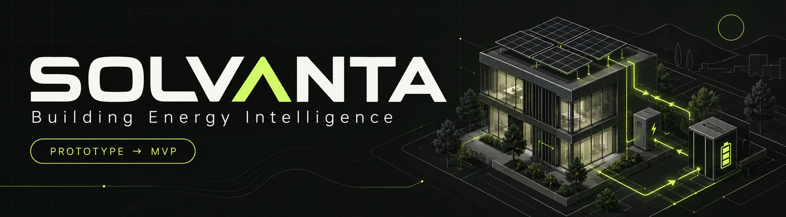
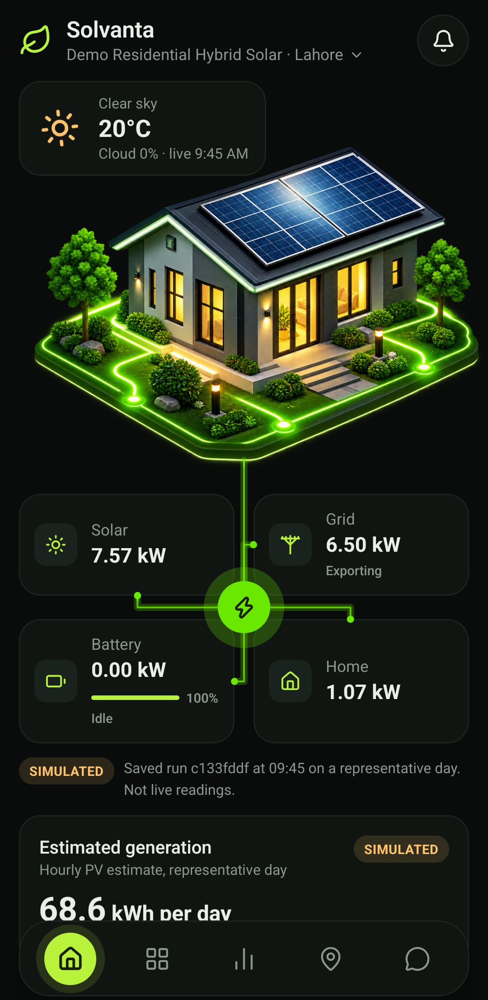
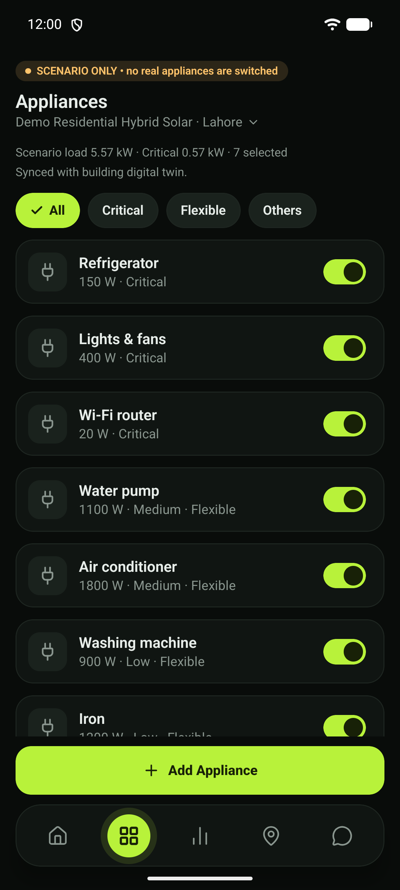
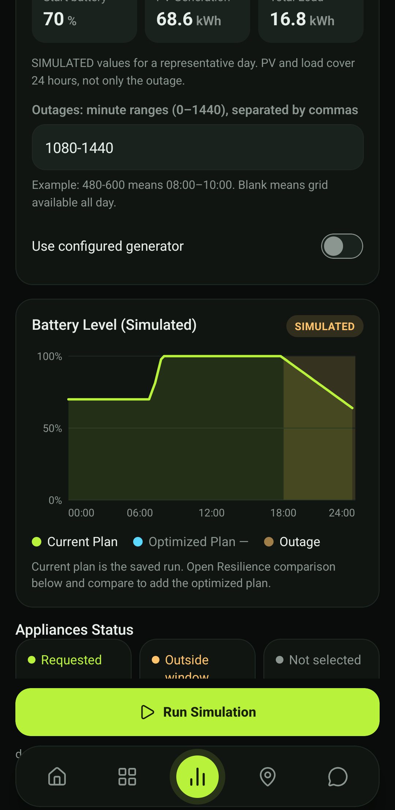
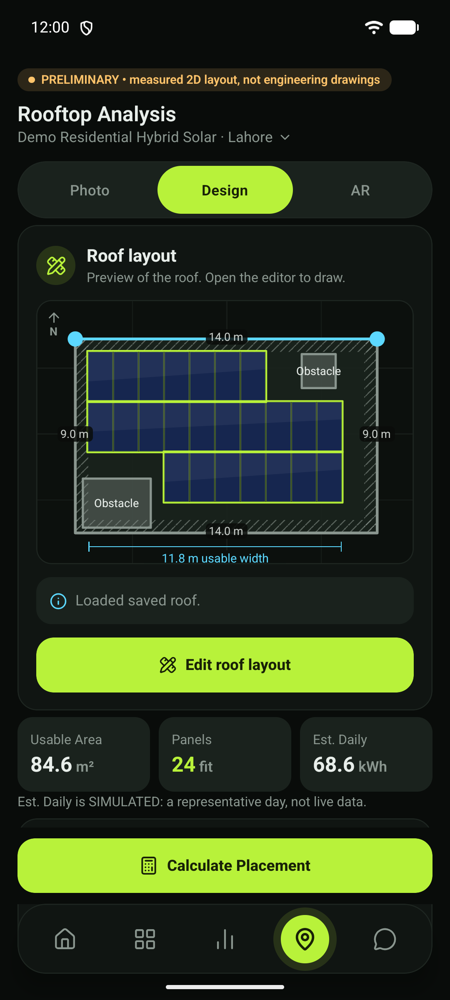
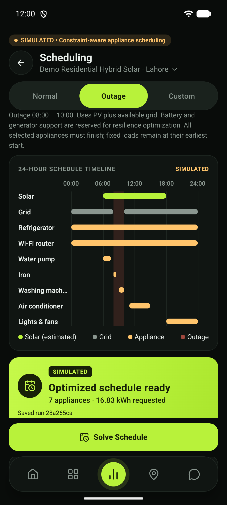
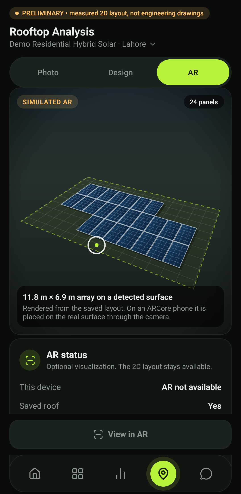
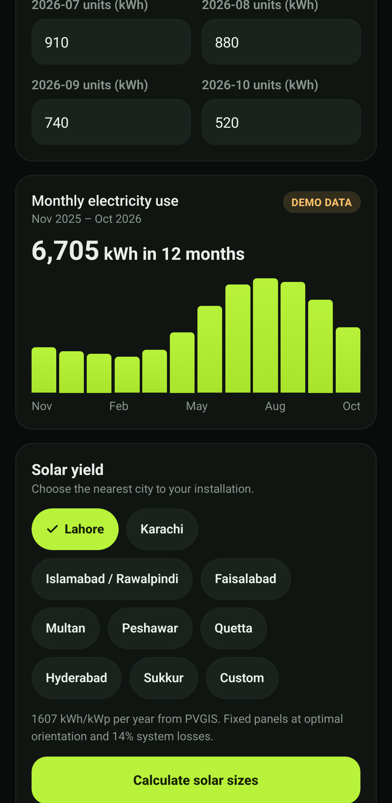
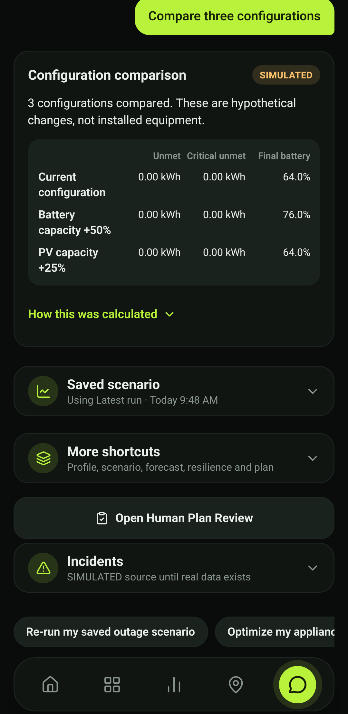

<p align="center">
  
</p>

<p align="center">
  <strong>LOCAL-FIRST · ANDROID · PROTOTYPE → MVP</strong><br />
  Model your energy. Understand your backup. Plan for the outage.
</p>

Solvanta is an Android building-energy digital twin. It brings rooftop solar design, appliance priorities and outage planning into one workflow. Every calculation runs on the phone and every record is stored in an on-device SQLite database. There is no server to run and nothing to deploy; the app works offline. Only sign-in and live weather use the internet.

## Screenshots

<table>
  <tr>
    <th width="25%">Home &amp; live weather</th>
    <th width="25%">Appliances &amp; priorities</th>
    <th width="25%">Outage simulation</th>
    <th width="25%">Rooftop &amp; PV design</th>
  </tr>
  <tr>
    <td></td>
    <td></td>
    <td></td>
    <td></td>
  </tr>
  <tr>
    <th>Appliance scheduling</th>
    <th>AR preview</th>
    <th>Bills &amp; solar sizing</th>
    <th>Engine tools</th>
  </tr>
  <tr>
    <td></td>
    <td></td>
    <td></td>
    <td></td>
  </tr>
</table>

*Screenshots from the Android development build with the built-in demo building. Weather is live; energy results are simulated, and the app never switches real equipment. The AR shot is the simulated preview shown on devices without ARCore; on an ARCore phone the same layout is placed through the camera.*

## What it does

### Building & appliance digital twin
Describe the building: solar array, inverter, battery, grid connection and an optional generator. Add appliances with their power, priority, required runtime and the hours they may run in, then choose which loads a scenario includes.

### Rooftop & solar planning
Trace the roof on a top-down photo, calibrate it with one measured distance, mark obstacles, and let Solvanta place panels with setbacks. The saved layout gives a PV capacity and an hour-by-hour generation estimate. **Preview in AR** places the saved layout on a real surface through ARCore.

### Solar sizing from an electricity bill
Photograph a Pakistani electricity bill. The phone reads the monthly *Units* history with on-device text recognition (the image never leaves the device). It then suggests an array size for your city's solar yield.

### Outage simulation & shortage forecast
Simulate a day in 15-minute steps: how solar, battery, grid and generator serve demand through the outages you set. See battery charge, unmet demand and shortages of critical loads, plus a next-day projection.

### Appliance scheduling
A constraint scheduler decides when each selected appliance runs. Every load completes its runtime inside its window, interruption limits are respected, and the available solar + grid power is never exceeded. Higher-priority loads are delayed least. It is a branch-and-bound search on the phone, checked against Google OR-Tools on reference cases.

### Backup resilience & what-if plans
Compare normal battery use with a critical-reserve strategy that keeps energy back for essential loads. Compare the current system with a bigger battery or more PV. Then take a plan through review: submit, approve, simulate and verify, with every step kept in an audit trail.

### Replay & operations
Replay a saved simulation step by step. Generate clearly labelled simulated telemetry, flag mismatches against the expected trace as incidents, and check them against a verified plan.

### Live weather
Current conditions and a three-day forecast for your city, plus a solar production forecast for your saved array, from [Open-Meteo](https://open-meteo.com) (no API key). The weather box animates sun, moon, clouds, rain, snow and lightning, and its colour follows the temperature. Offline, it shows only the sun or the moon for the time of day.

## How it works

```
React Native app (Expo, TypeScript)
├── Screens ──────────► api client (same routes as the old REST API)
│                         ├── on-device engine ── SQLite (expo-sqlite)
│                         │     simulation · PV · roof geometry · scheduler
│                         │     forecast · resilience · plans · telemetry
│                         └── weather ─────────── Open-Meteo (online)
├── Sign-in ──────────► Firebase Authentication (online) or guest mode
├── Bill reading ─────► ML Kit text recognition (on device)
└── AR preview ───────► ViroReact + ARCore (on device)
```

The engines began as a Python/FastAPI backend and were ported to TypeScript. A parity test still compares them with the reference outputs of the original Python code (`mobile/__tests__/local_engine_parity.test.ts`).

## Tech stack

| Area | Technologies |
|---|---|
| App | React Native 0.86 · Expo SDK 57 · TypeScript · Expo Router · Reanimated |
| Data | SQLite (expo-sqlite), on the device |
| Engines | TypeScript: energy simulation, PV model, Clipper polygon geometry, branch-and-bound scheduler |
| On-device ML & AR | Google ML Kit text recognition · ViroReact · ARCore |
| Online services | Firebase Authentication · Open-Meteo weather |
| Testing | Jest (900+ tests) · TypeScript strict mode |

## Run it

The app needs a development build, not Expo Go, because AR, text recognition and Google sign-in are native modules.

```bash
cd mobile
npm install --legacy-peer-deps
npx expo run:android        # builds and installs the development build on a device or emulator
```

AR needs a real ARM phone with ARCore: ViroReact ships its renderer only for ARM (arm64-v8a, armeabi-v7a), so an x86_64 emulator cannot run the AR preview. Run the tests with `npm test` and the type check with `npx tsc --noEmit`.

## Status

The full workflow runs on the device. Next: user testing on phones, the remaining visual polish, and removing the retired Python backend from the repository. Energy figures are simulated estimates for planning, not engineering sign-off.

[Product status](docs/STATUS.md) · [Architecture](docs/ARCHITECTURE.md)
