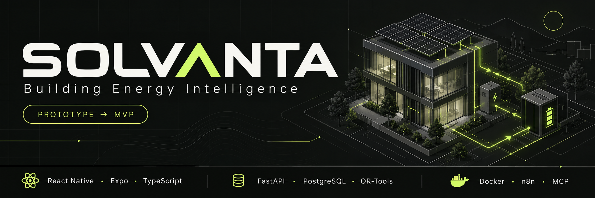
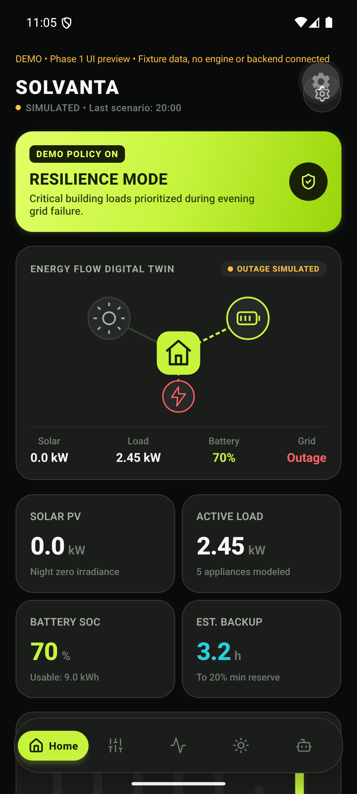
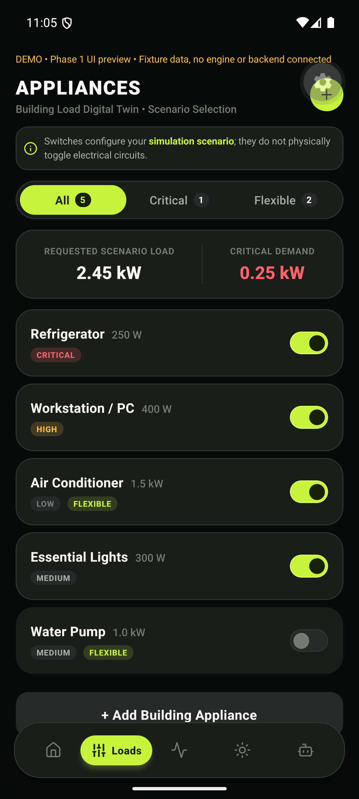
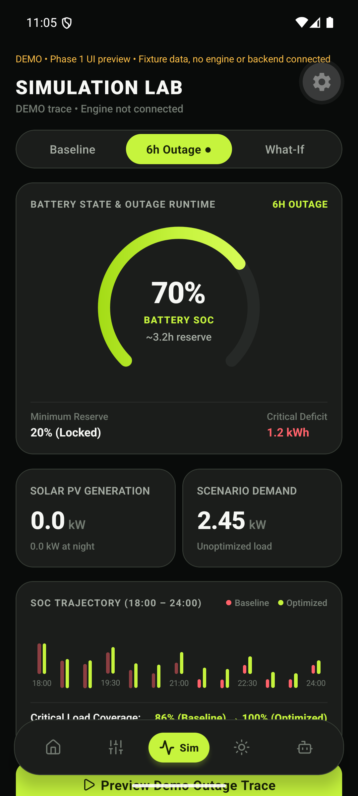
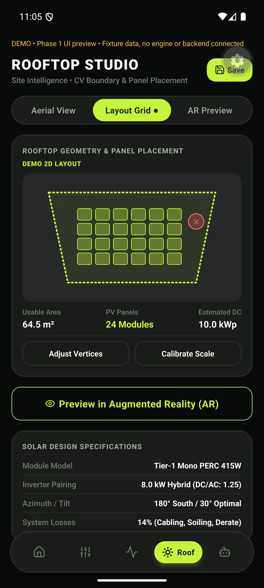

  

  <strong>PROTOTYPE PHASE · MOVING TOWARDS MVP</strong> 
  Model your energy. Understand your backup. Plan for the outage.

Solvanta is an Android-first building energy digital twin that brings solar design, appliance priorities and backup planning into one workflow. Explore what happens during a power outage, compare alternatives and review a plan before running its simulation.

## Inside the prototype

<table>
  <tr>
    <th width="25%">Energy overview</th>
    <th width="25%">Load priorities</th>
    <th width="25%">Outage scenarios</th>
    <th width="25%">Rooftop studio</th>
  </tr>
  <tr>
    <td></td>
    <td></td>
    <td></td>
    <td></td>
  </tr>
</table>

*Screenshots show the earlier Android UI prototype with fixture data. The current integrated build and its validation are documented in the [project status](docs/STATUS.md); the final visual overhaul is still ahead.*

## What it does

- **Model the building:** calibrated roof geometry, PV estimates, battery configuration and appliance constraints.
- **Plan for outages:** energy-balance simulation, shortage projections, constrained scheduling and resilience comparisons.
- **Keep decisions reviewable:** approval records, saved-run replay, simulated incident evidence, n8n workflows and nine authenticated MCP tools.

## Tech stack

| Layer | Technologies |
|---|---|
| Mobile | React Native · Expo · TypeScript · Expo Router |
| API & data | Python · FastAPI · Pydantic · SQLAlchemy · PostgreSQL |
| Engines & operations | OR-Tools · Docker · n8n · Official Python MCP SDK |

## Run locally

Use **Python 3.13**, **Node.js 24** and **Docker**. The [setup guide](docs/RELEASE_HANDOFF.md) covers the database, demo seed, API and Expo preview.

[Architecture](docs/ARCHITECTURE.md) · [MCP tools](docs/MCP.md) · [Validation & delivery](docs/DELIVERY_LEDGER.md)

## Towards MVP

The core simulation workflow is implemented. Next are the remaining GUI overhaul, AR/VR, native dev-client/APK validation and user testing. Energy results and telemetry are simulated; the prototype does not control electrical equipment.
