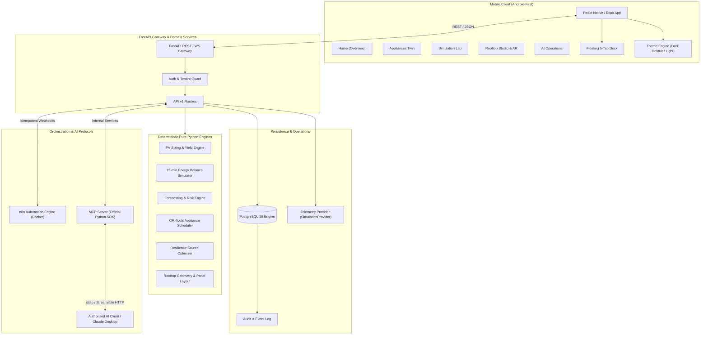

# Solvanta — System Architecture Specification

## 1. Executive Topology

Solvanta is architected as an Android-first mobile digital twin, backed by an asynchronous Python service layer, relational time-series database, workflow automation orchestrator, and an authorized Model Context Protocol (MCP) server.



---

## 2. Canonical Decision Loop Sequence

The core Solvanta resilience cycle operates through an auditable, nine-step decision loop:

```mermaid
sequenceDiagram
    autonumber
    actor User as Homeowner / Engineer
    participant Mobile as Mobile App (Expo)
    participant API as FastAPI Backend
    participant Sim as Deterministic Simulator
    participant Opt as OR-Tools Optimizer
    participant DB as PostgreSQL
    participant n8n as n8n Orchestrator
    participant MCP as MCP Server

    User->>Mobile: Define Scenario (Outage 18:00–22:00, 70% SoC, Loads)
    Mobile->>API: POST /api/v1/simulations (Run Baseline)
    API->>Sim: Execute 15-min energy balance
    Sim-->>API: Baseline timeline (Unserved critical energy detected)
    API->>DB: Persist Simulation Run #1
    API-->>Mobile: Return Baseline Result & Risk Alert

    alt Automated Shortage Detection
        API->>n8n: Trigger Event (Shortage Risk Detected)
        n8n->>API: Request Optimization Plan
    else User Initiated
        Mobile->>API: POST /api/v1/resilience/optimize
    end

    API->>Opt: Solve constrained load schedule & source dispatch
    Opt-->>API: Feasible Energy Plan (Status: PENDING_APPROVAL)
    API->>DB: Persist Plan #101 (DRAFT/PENDING)
    API-->>Mobile: Present Recommended Plan Card (Neon Hero)

    User->>Mobile: Review Plan Details & Tap [Approve]
    Mobile->>API: POST /api/v1/energy-plans/101/approve
    API->>DB: Update Plan #101 -> APPROVED (Audit Logged)
    API->>Sim: Simulate Approved Action (Run Revised Trace)
    Sim-->>API: Verified Revised Outcome (Critical coverage: 100%)
    API->>DB: Persist Verification Result
    API-->>Mobile: Display Verified Digital Twin Playback

    opt AI Query via MCP
        MCP->>API: get_energy_scenario(scenario_id)
        API-->>MCP: Return verified scenario & timeline
    end
```

---

## 3. Subsystem Breakdown

### 3.1 Mobile Client (`mobile/`)
- **Technology:** React Native 0.76+, Expo SDK (AR-compatible pinned version), Expo Router, TypeScript.
- **Visual Design:** Strictly implements `UI_DESIGN_SPEC.md` based on `Neon_Smart_Home_Reference.png`.
- **Dock:** 5-tab floating capsule with bottom safe area offset (`Home`, `Appliances`, `Simulation`, `Rooftop`, `AI`).
- **Theme State:** Dark mode as default on cold launch; persistent Light mode via local storage rehydration.
- **Chart Visualizations:** Deterministic SVG energy flows, battery SoC radial gauge, 15-minute load curves.

### 3.2 Backend Service Layer (`backend/`)
- **Technology:** Python 3.11+, FastAPI, Pydantic v2, SQLAlchemy 2.0 async.
- **Layering:**
  - `app/api/v1/`: Thin HTTP/WebSocket controllers.
  - `app/services/`: Application services, business logic, authorization, plan state machine.
  - `app/engines/`: Pure, mathematically deterministic calculators.
  - `app/models/` & `app/schemas/`: Declarative database entities and Pydantic validation contracts.
  - `app/mcp/`: Model Context Protocol server exposing typed tools.

### 3.3 Quantitative Engineering Engines (`backend/app/engines/`)
1. **PV Yield Engine (`pv`):**
   - Panel kWp nameplate rating, tilt, orientation, inverter DC/AC ratio, temperature coefficient, and wiring/inverter losses.
2. **Energy Balance Simulator (`simulation`):**
   - 15-minute discrete-time simulation.
   - Strict conservation of energy: $E_{\text{pv}} + E_{\text{grid}} + E_{\text{bat,dis}} + E_{\text{gen}} = E_{\text{load,served}} + E_{\text{bat,chg}} + E_{\text{curtail}} + E_{\text{loss}}$.
   - Battery SoC limits: $SoC_{\text{min}} \le SoC(t) \le SoC_{\text{max}}$.
3. **Forecasting Engine (`forecasting`):**
   - Transparent profile-based baseline forecasting with evaluation metrics (MAE, RMSE).
4. **Appliance Scheduler (`scheduling`):**
   - Google OR-Tools CP-SAT solver with hard constraints for appliance runtime, deadline windows, and interruption limits.
5. **Outage Resilience Optimizer (`resilience`):**
   - Energy source allocation and critical load shedding policies compared against an unoptimized baseline.
6. **Rooftop CV & Geometry (`cv`):**
   - Polygon boundary calculation, obstacle exclusion masks, panel layout packing, and usable area estimation.

### 3.4 Data & Persistence (`backend/app/db/`)
- **Engine:** PostgreSQL 16 Alpine in Docker Compose.
- **Migrations:** Alembic for automated schema versioning.
- **Data Provenance:** Every time-series record tags its origin (`synthetic`, `user_entered`, `calculated`, `forecast`, `simulated`).

### 3.5 Automation & MCP (`automation/` & `backend/app/mcp/`)
- **n8n:** Version-controlled JSON workflow templates running in Docker. Handles event queues, automated reminders, and scheduled daily optimization passes.
- **MCP Server:** Implemented via official `mcp` Python SDK, exposing 9 typed tools for scenario queries, outage simulations, and plan proposals.

---

## 4. Security & Network Configuration

- **Local Network Binding:**
  - Android Emulator: Connects to host machine via `http://10.0.2.2:8000`.
  - Physical Mobile Device: Connects via local WiFi LAN IP (e.g., `http://192.168.1.X:8000`).
  - Web development client: Connects via `http://localhost:8000`.
- **Tenant & Identity Isolation:**
  - Every resource (`building`, `scenario`, `plan`, `sim_result`) is tied to a user/organization ID.
  - Cross-tenant data access is rejected with `403 Forbidden`.
- **Secrets Management:**
  - Zero hardcoded secrets. All environment variables defined in `.env.example`.
  - AI API keys reside solely on the backend; never leaked to mobile client bundles.
