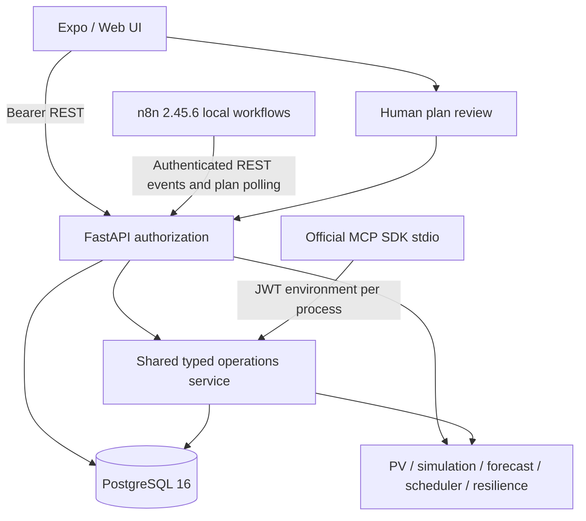

# Implemented architecture — Phase 17 source candidate

React Native / Expo SDK 58 (React 19.3, React Native 0.88.1) uses authenticated REST against FastAPI. PostgreSQL 16 stores users/organizations, buildings, roof/PV inputs, appliance constraints, immutable simulation snapshots, schedules, resilience runs, energy plans, audit logs, automation events, simulated telemetry and incidents. Alembic is the schema authority. WebSockets, automatic roof segmentation and native AR are not implemented.

`app/services/` owns deterministic calculations. `app/api/v1/endpoints/` applies building access and persists results; `services/operations.py` reuses these guards and engines for both the HTTP tool gateway and stdio adapter. Outputs label configuration/simulation provenance and use explicit W/kW/kWh/% units. A saved run UUID is the tool scenario ID, not a mutable building configuration pointer.

Simulation uses 96 quarter-hour AC energy-balance intervals. Charge/discharge and import/export are separate nonnegative flow fields. Battery floor is the greater of nominal minus usable capacity and nominal times reserve percentage. No battery aging, electrical transients or hardware switching are modeled. Forecasts are daily persistence of configured/simulated profiles, with no trained-model accuracy claim. Minute-resolution scheduling uses PV plus available grid, independently validates every selected load and declares infeasibility/timeouts. Resilience is a conservative critical-reserve heuristic with baseline fallback, not a global optimization certificate.

Plans transition DRAFT → PENDING_APPROVAL → APPROVED → SIMULATED → VERIFIED (or explicit rejection/modification/failure), using revisions, row locks and idempotency receipts. Verification replays approved immutable inputs and checks physical invariants. MCP proposals start PENDING_APPROVAL and expose no approval tool. n8n can coordinate an already approved plan's simulated execution; it does not grant approval or control circuits.

n8n has three exported workflows: shortage, daily planner and anomaly incident. Durable waits survive process restart; API event IDs prevent duplicate initiation. The anomaly scheduler consumes open SIMULATED incidents. Credential imports remain local and are absent from exports. See `workflows/README.md`, Phase 13 restart evidence and Phase 14 detector evidence.

The backend launcher binds all IPv4 interfaces. Expo Go derives the API host from its current LAN manifest; web uses its hostname when no override is configured. A changed network needs a current Expo session/QR, not a hard-coded API IP. Isolated Wi-Fi clients still require a reachable shared network. Development uses plaintext local HTTP and example credentials; production needs HTTPS, secret rotation, restricted CORS and a separate operational review.

2D replay uses the selected saved trace. AR/VR, remaining visual overhaul, native packaging, actual telemetry, forecast evaluation on observations and stakeholder usability acceptance are deferred or unperformed. See `RELEASE_HANDOFF.md` for the evidence boundary.
